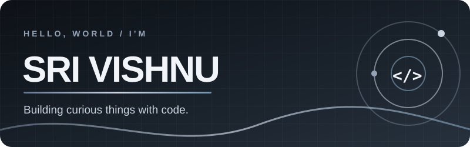
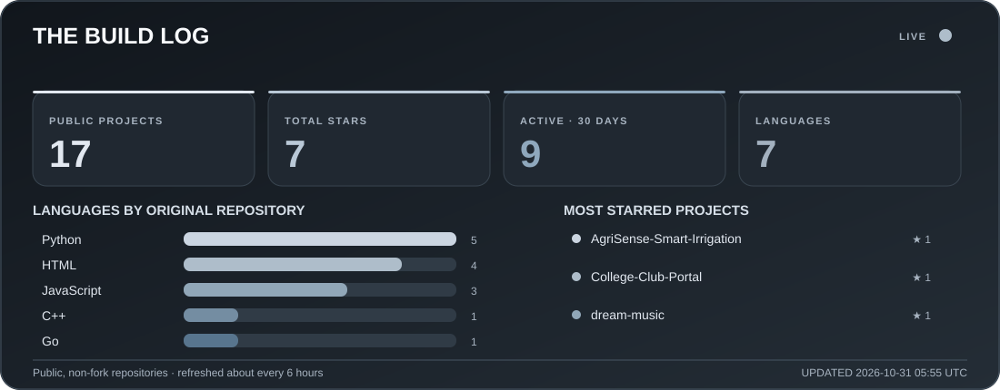
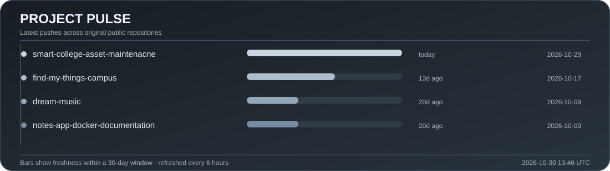

<table>
  <tr>
    <td align="center" width="260">
      
    </td>
    <td></td>
  </tr>
</table>

  
<strong>AI · full-stack · IoT</strong> Turning ideas into useful software, from Go services to intelligent interfaces and connected devices.

  
  
  

---

### 📊 The build log

  
  

Stats count public, non-fork repositories and refresh about every six hours. “Active” means a project was pushed in the last 30 days.

---

### ✦ Currently building

- 🎵 **[Dream Music](https://github.com/SriVishnu230707/dream-music)** — a mood-aware music project built with **Go** and PostgreSQL.
- 🌍 **[OpenSRE](https://github.com/SriVishnu230707/opensre)** — exploring AI agents for infrastructure incident response.
- 🏛️ **[MPLADS Sentinel AI](https://github.com/SriVishnu230707/mplads-sentinel-ai)** — risk intelligence and monitoring for public projects.

### ⚡ More things I've made

[Ticker Room](https://github.com/SriVishnu230707/ticker-room) · [Spam SMS Detection](https://github.com/SriVishnu230707/spam-sms-detection) · [AgriSense Smart Irrigation](https://github.com/SriVishnu230707/AgriSense-Smart-Irrigation) · [InterviewIQ](https://github.com/SriVishnu230707/interviewiq) · [Nexus Contact Space](https://github.com/SriVishnu230707/nexus-contact-space) · [Depthboard](https://github.com/SriVishnu230707/depthboard) · [Orbit OS](https://github.com/SriVishnu230707/orbit-os) · [Command-Line Ludo](https://github.com/SriVishnu230707/Ludo-game-enhanced)

### 🧰 Toolbox

**Languages:** Go · Python · TypeScript · JavaScript · C++ · C · SQL

**Web & APIs:** React · FastAPI · Node.js · Express · Socket.IO · Tailwind CSS

**Data & AI:** PostgreSQL · MongoDB · Redis · scikit-learn · Pandas · NumPy

**Devices & workflow:** ESP32 · Arduino · Docker · GitHub Actions · Vercel

### 🛰️ Fresh from my repositories

Updated about every six hours from my public repositories.

<!-- RECENT_REPOS_START -->
- **[smart-college-asset-maintenacne](https://github.com/SriVishnu230707/smart-college-asset-maintenacne)** · Python · last pushed 2026-10-29 18:55 UTC
- **[opensre](https://github.com/SriVishnu230707/opensre)** · Python · last pushed 2026-10-29 14:55 UTC
- **[tailcat](https://github.com/SriVishnu230707/tailcat)** · Go · last pushed 2026-10-29 14:49 UTC
- **[postgres](https://github.com/SriVishnu230707/postgres)** · C · last pushed 2026-10-29 14:33 UTC
- **[ipatool](https://github.com/SriVishnu230707/ipatool)** · Mixed stack · last pushed 2026-10-22 07:28 UTC
- **[superfile](https://github.com/SriVishnu230707/superfile)** · Go · last pushed 2026-10-22 07:17 UTC
<!-- RECENT_REPOS_END -->

### 🐍 Activity trail

  <picture>
    <source media="(prefers-color-scheme: dark)" srcset="https://raw.githubusercontent.com/SriVishnu230707/SriVishnu230707/output/github-contribution-grid-snake-dark.svg" />
    <source media="(prefers-color-scheme: light)" srcset="https://raw.githubusercontent.com/SriVishnu230707/SriVishnu230707/output/github-contribution-grid-snake.svg" />
    
  </picture>

---

  “Anyone can wear the mask. You can wear the mask.” 🕷️

